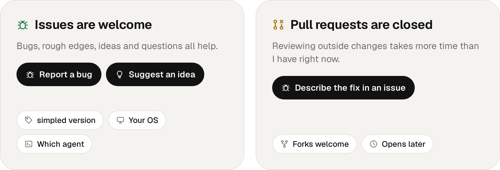
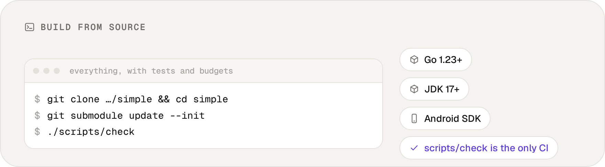
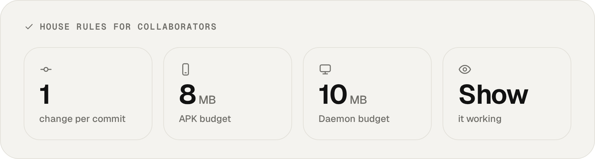

<p align="center">
  <picture><source media="(prefers-color-scheme: dark)" srcset="docs/readme/parts/c-head-dark.png"></picture>
</p>

<p align="center">
  <a href="https://github.com/HoneyPaptan/simple/issues/new/choose"><picture><source media="(prefers-color-scheme: dark)" srcset="docs/readme/parts/c-ways-dark.png"></picture></a>
</p>

<p align="center">
  <picture><source media="(prefers-color-scheme: dark)" srcset="docs/readme/parts/c-build-dark.png"></picture>
</p>

```sh
git clone https://github.com/HoneyPaptan/simple && cd simple
git submodule update --init
./scripts/check
```

<p align="center">
  <a href="AGENTS.md"><picture><source media="(prefers-color-scheme: dark)" srcset="docs/readme/parts/c-rules-dark.png"></picture></a>
</p>

<details>
<summary>Details for collaborators</summary>

- Set `ANDROID_HOME` or `app/local.properties`. `scripts/check` runs the daemon tests, the app unit tests and lint, a release build and the size budgets.
- Try the daemon against your own agents with `cd daemon && go run ./cmd/simpled serve`, then `simpled pair` and a debug build of the app (`cd app && ./gradlew installDebug`).
- Wire changes start in `docs/protocol.md` and `proto/fixtures/`, then both sides follow.
- No new dependency without a short note in `docs/decisions/`.
- UI text uses no dash characters; use commas, colons or two sentences.
- A new agent needs a transcript parser in `daemon/internal/transcript/`, a kind in `daemon/internal/agents/` and tests with a scrubbed real transcript. Codex support exists but is not tested end to end yet.

</details>
