<p align="center">
  <picture><source media="(prefers-color-scheme: dark)" srcset="docs/readme/hero-dark.svg"></picture>
</p>

<p align="center">
  <picture><source media="(prefers-color-scheme: dark)" srcset="docs/readme/parts/r-lockup-dark.png">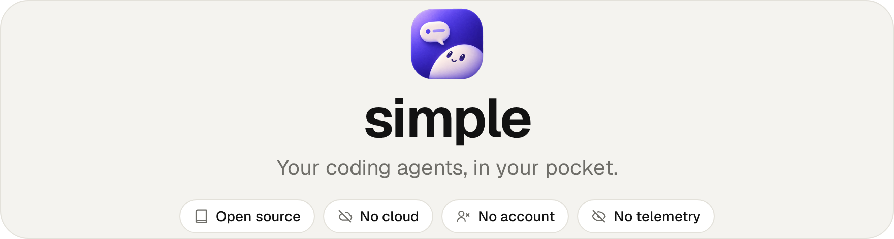</picture>
</p>

<p align="center">
  <a href="#install"><picture><source media="(prefers-color-scheme: dark)" srcset="docs/readme/parts/pill-install-dark.png"></picture></a>
  <a href="#how-it-works"><picture><source media="(prefers-color-scheme: dark)" srcset="docs/readme/parts/pill-how-dark.png"></picture></a>
  <a href="SECURITY.md"><picture><source media="(prefers-color-scheme: dark)" srcset="docs/readme/parts/pill-security-dark.png"></picture></a>
  <a href="https://github.com/HoneyPaptan/simple/issues"><picture><source media="(prefers-color-scheme: dark)" srcset="docs/readme/parts/pill-issues-dark.png"></picture></a>
  <a href="#side-project"><picture><source media="(prefers-color-scheme: dark)" srcset="docs/readme/parts/pill-side-dark.png"></picture></a>
</p>

<p align="center">
  <picture><source media="(prefers-color-scheme: dark)" srcset="docs/readme/card-start-dark.png">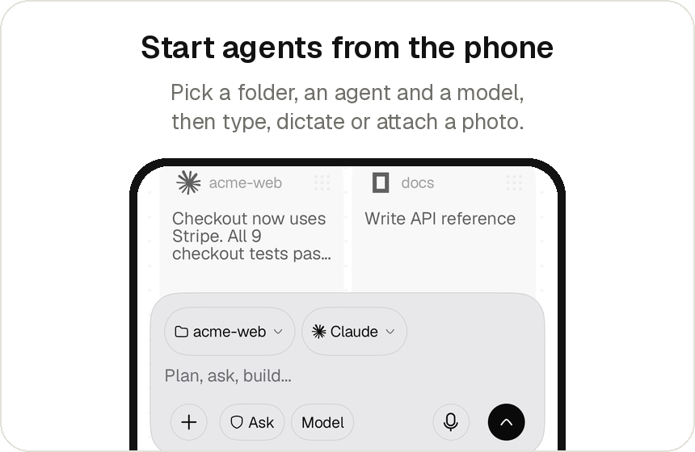</picture>
  <picture><source media="(prefers-color-scheme: dark)" srcset="docs/readme/card-approve-dark.png">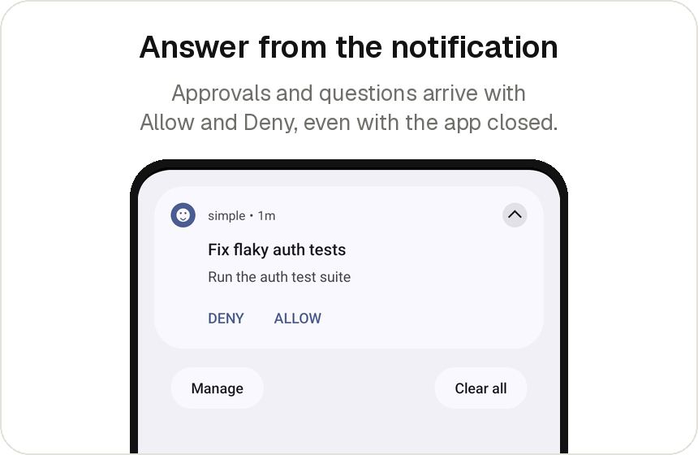</picture>
</p>

<p align="center">
  <picture><source media="(prefers-color-scheme: dark)" srcset="docs/readme/card-chat-dark.png">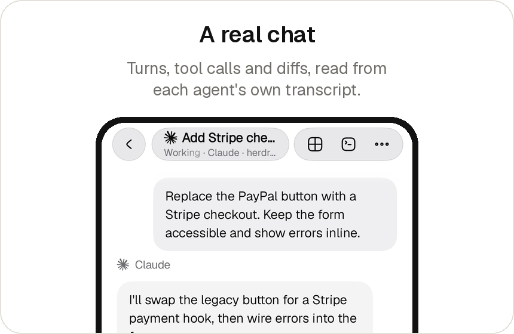</picture>
  <picture><source media="(prefers-color-scheme: dark)" srcset="docs/readme/card-review-dark.png">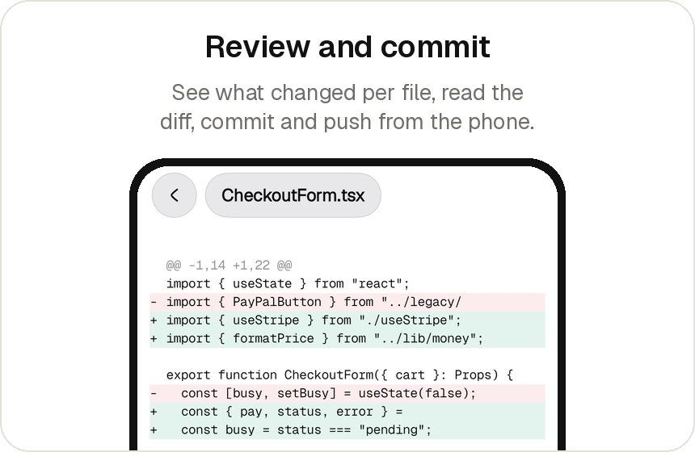</picture>
</p>

<p align="center">
  <picture><source media="(prefers-color-scheme: dark)" srcset="docs/readme/parts/r-tiles-dark.png">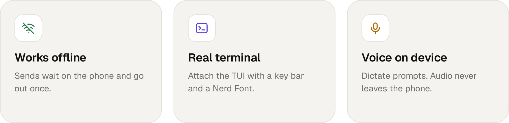</picture>
</p>

<p align="center">
  <picture><source media="(prefers-color-scheme: dark)" srcset="docs/readme/screens-dark.png">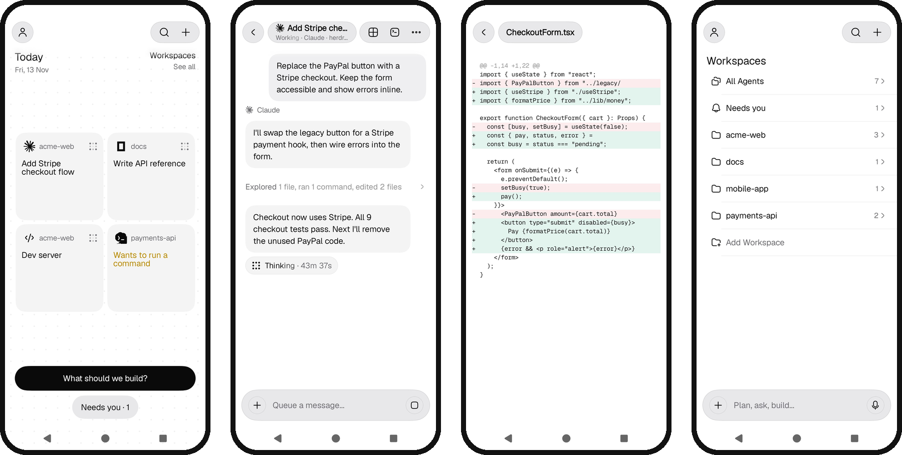</picture>
</p>

<p align="center">
  <picture><source media="(prefers-color-scheme: dark)" srcset="docs/readme/parts/r-agents-dark.png">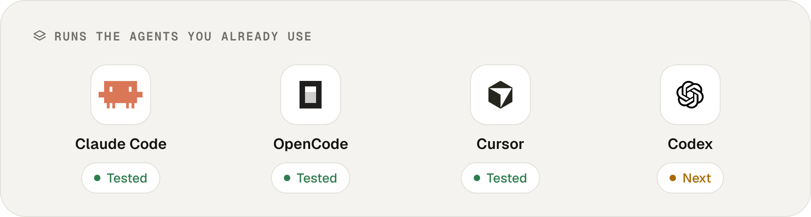</picture>
</p>

<a name="install"></a>

<p align="center">
  <a href="https://github.com/HoneyPaptan/simple/releases/latest"><picture><source media="(prefers-color-scheme: dark)" srcset="docs/readme/parts/r-install-dark.png">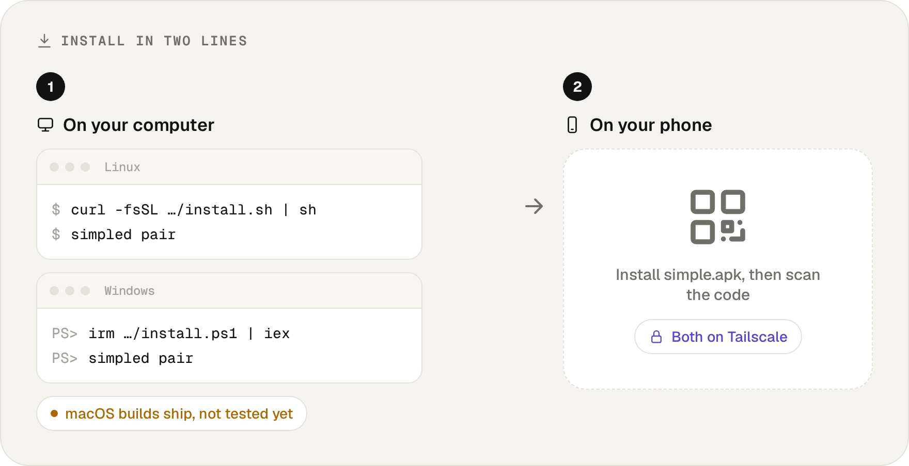</picture></a>
</p>

```sh
# Linux and macOS
curl -fsSL https://github.com/HoneyPaptan/simple/releases/latest/download/install.sh | sh
simpled pair
```

```powershell
# Windows
irm https://github.com/HoneyPaptan/simple/releases/latest/download/install.ps1 | iex
simpled pair
```

<details>
<summary>Pair over home Wi-Fi without Tailscale</summary>

Set `"lan": true` in simpled's `config.json`, run `simpled install` to restart it, then run `simpled pair` again. `simpled status` shows whether the daemon runs, `simpled devices` lists paired phones and `simpled devices rm <id>` revokes one. Run the install command again to update.

</details>

<a name="how-it-works"></a>

<p align="center">
  <a href="docs/architecture.md"><picture><source media="(prefers-color-scheme: dark)" srcset="docs/readme/parts/r-how-dark.png">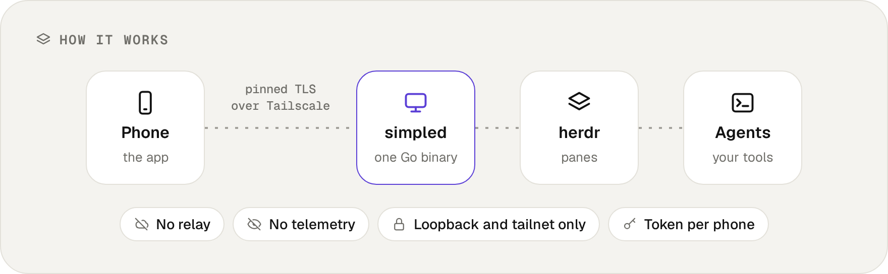</picture></a>
</p>

<p align="center">
  <a href="docs/perf.md"><picture><source media="(prefers-color-scheme: dark)" srcset="docs/readme/parts/r-numbers-dark.png">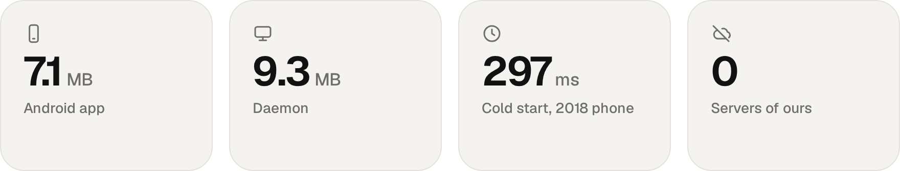</picture></a>
</p>

<a name="side-project"></a>

<p align="center">
  <picture><source media="(prefers-color-scheme: dark)" srcset="docs/readme/parts/r-side-dark.png"></picture>
</p>

<p align="center">
  <a href="https://github.com/HoneyPaptan/simple/issues/new/choose"><picture><source media="(prefers-color-scheme: dark)" srcset="docs/readme/parts/pill-issues-welcome-dark.png"></picture></a>
  <a href="CONTRIBUTING.md"><picture><source media="(prefers-color-scheme: dark)" srcset="docs/readme/parts/pill-prs-closed-dark.png"></picture></a>
  <a href="SECURITY.md"><picture><source media="(prefers-color-scheme: dark)" srcset="docs/readme/parts/pill-security-private-dark.png"></picture></a>
</p>

<p align="center">
  <a href="docs/licenses.md"><picture><source media="(prefers-color-scheme: dark)" srcset="docs/readme/parts/r-foot-dark.png"></picture></a>
</p>
