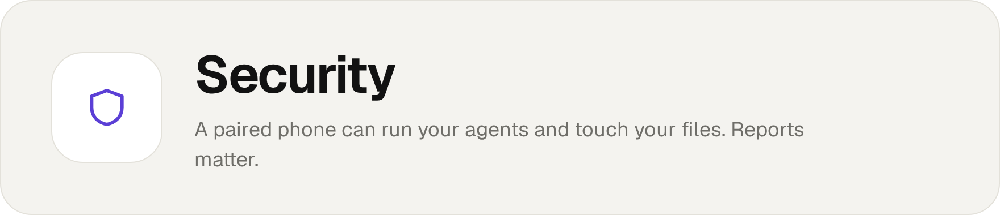
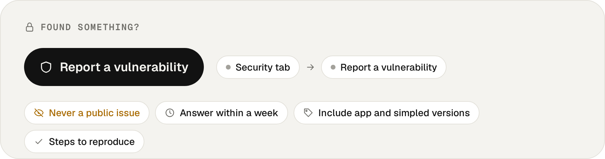
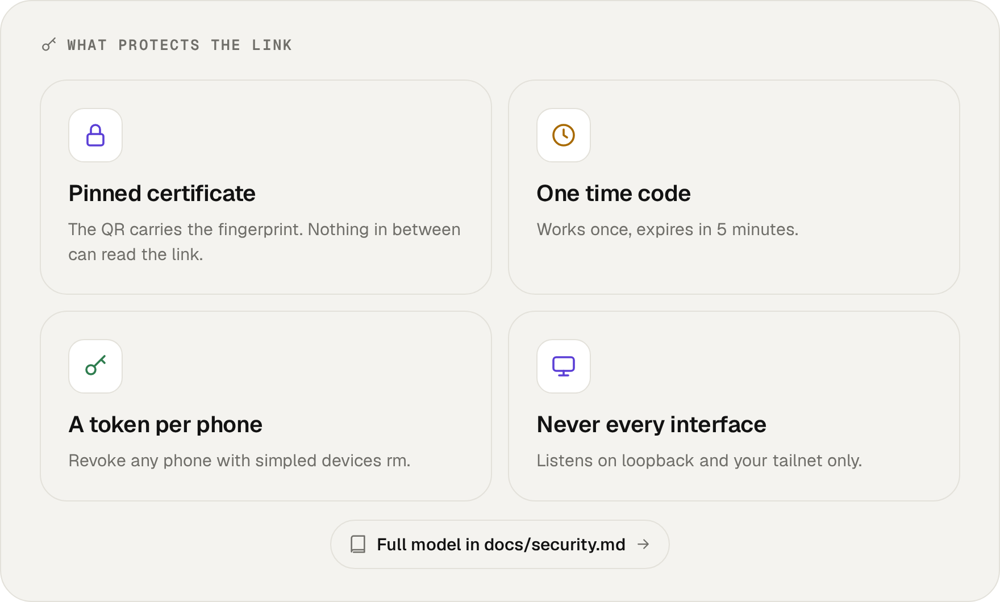

  <picture><source media="(prefers-color-scheme: dark)" srcset="docs/readme/parts/s-head-dark.png"></picture>

  <a href="https://github.com/HoneyPaptan/simple/security/advisories/new"><picture><source media="(prefers-color-scheme: dark)" srcset="docs/readme/parts/s-report-dark.png"></picture></a>

  <a href="docs/security.md"><picture><source media="(prefers-color-scheme: dark)" srcset="docs/readme/parts/s-model-dark.png"></picture></a>

  <picture><source media="(prefers-color-scheme: dark)" srcset="docs/readme/parts/s-versions-dark.png"></picture>

